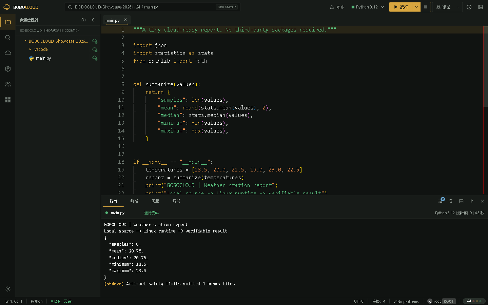
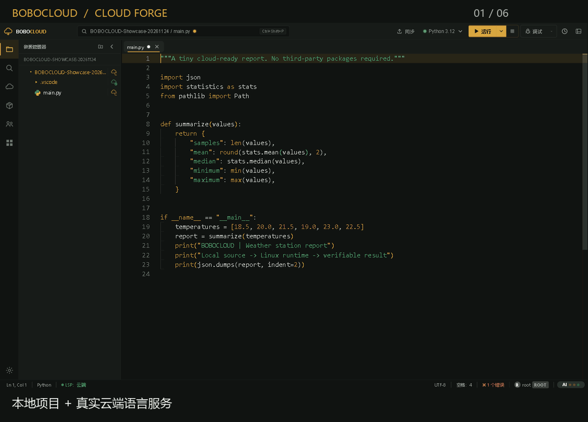
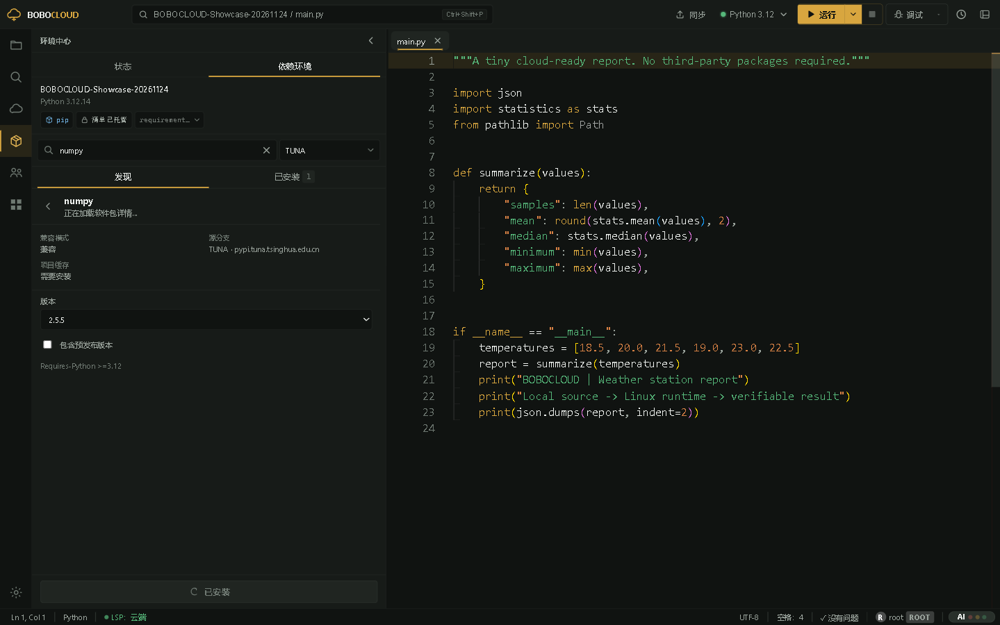
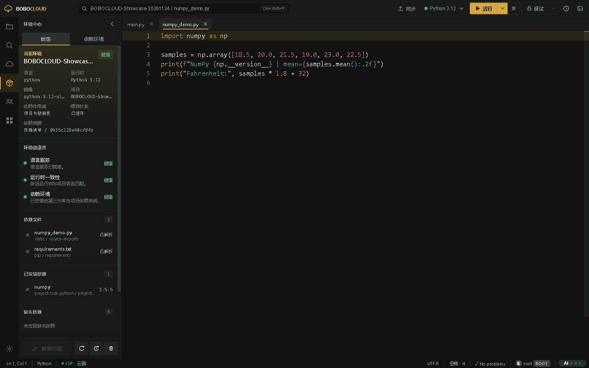
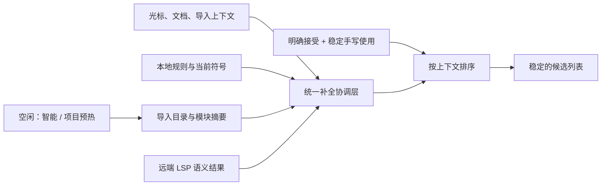
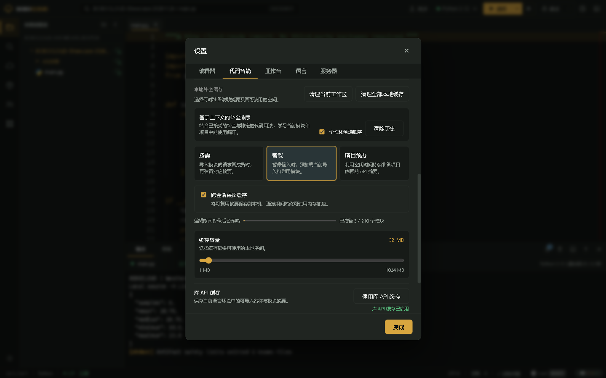
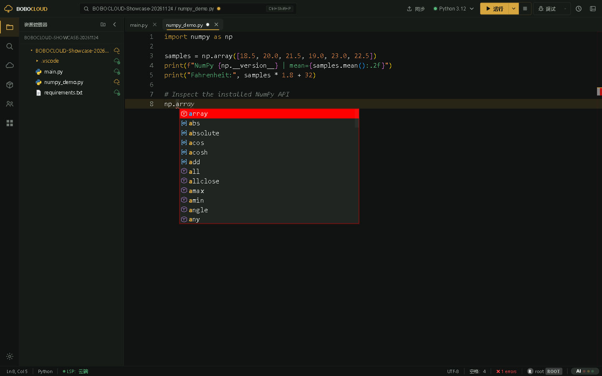
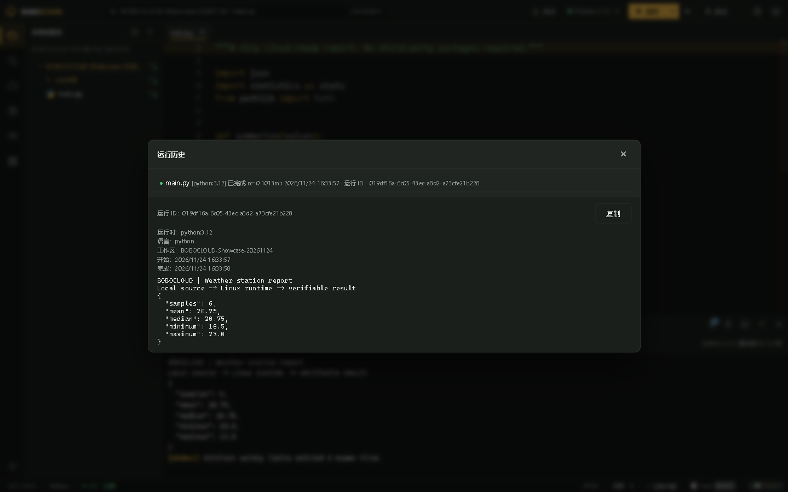
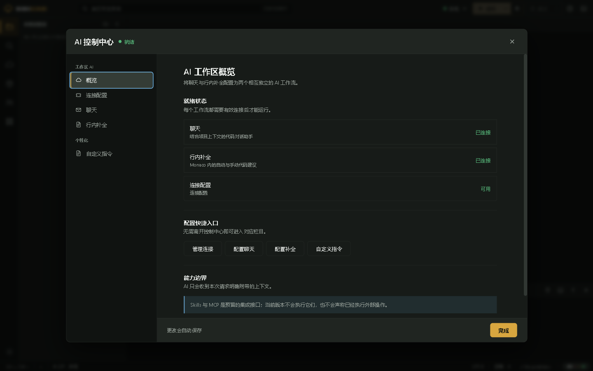
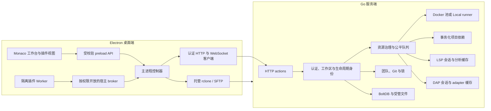

# BOBOCLOUD

<p align="right"><a href="README.md">English</a> | <strong>简体中文</strong></p>

BOBOCLOUD 是一套可自行部署的云端开发工作台：Electron 桌面端负责保存和编辑开发者电脑上的项目，Go 服务端负责 Linux 执行、Docker 运行时、项目依赖环境、任务、终端、语言智能、调试、团队协作与资源治理。当前源码中的客户端版本为 **3.0.2**，服务端版本为 **3.0.2**。

**源码留在本地，工具链放到云端。** 打开普通项目文件夹，选择服务器运行时，就能在同一桌面工作台里运行、查看结果、调试和扩展。只编辑文件时不需要云账号；连接服务后再使用远程能力。

本文于 **2026-11-26** 按当前源码更新，中文与 [English](README.md) 使用相同章节结构。当前 Plugin API 为 **1.12.0**。实际可用的镜像、调试器、配额及可选插件取决于你的部署。

没有服务器时，桌面端仍然可以打开文件夹、使用 Monaco 编辑器、搜索、查看 Problems 并调整工作台。运行、调试、云终端、项目依赖、团队和服务器存储则需要先连接兼容的 BOBOCLOUD 服务。

| 我想做什么 | 建议先读 |
| --- | --- |
| 编辑并运行一个项目 | [用户端使用者](#用户端使用者) |
| 理解项目依赖与缓存 | [项目依赖中心](#项目依赖中心)和[缓存模型](#缓存模型) |
| 运维一台编译服务器 | [服务器运维者](#服务器运维者) |
| 编写一个插件 | [插件开发者](#插件开发者) |
| 修改 BOBOCLOUD 本体 | [贡献者](#贡献者) |



### 先看一个真实项目



这段节选使用新建的独立演示项目、真实账号与真实服务，统一采用 **Cloud Forge**。演示包含模块补全和云端运行；等待片段经过缩短，因此 GIF 不是延迟测试。[复现同一项目](examples/cloud-tour/README.md) · [素材来源说明](docs/media/README.md)。

| 下一步阅读 | 适合谁 |
| --- | --- |
| [小白上手教程](docs/getting-started.zh-CN.md) | 首次启动、连接、第一次运行、安装依赖、调试和常见问题。 |
| [性能与架构说明](docs/performance-and-architecture.zh-CN.md) | 缓存了什么、为什么有效、隔离边界、事实依据和当前限制。 |
| [新手指引设计提案](docs/onboarding-design.zh-CN.md) | 首次运行指引、连接诊断与生命周期集成的设计，尚未实现。 |
| [插件快速入门](docs/plugin-quickstart.zh-CN.md) | 打包真实示例、理解权限、选择合适的扩展入口。 |
| [参与贡献](CONTRIBUTING.zh-CN.md) | 找到功能所属模块、选择有效测试、提交聚焦的改动。 |


## 3.0.0：邀请链接与首次安全连接

客户端与服务端均升级到 **3.0.0**，使用同一个通用安装包，无需企业重新编译。编辑区域的欢迎页可选中文、英文或日文，解析邀请链接、验证自签名 TLS 身份并展示服务器概览；确认后显示欢迎动画，再进入相应的登录或注册页面。仍可直接选择仅本地编辑。

## 3.0.2：账号管理与邀请工作区

右下角头像菜单新增**账号管理**，集中展示本机已认证账号的头像、账号 ID 和 UID，当前登录账号置顶。悬停或键盘聚焦账号卡片后，侧滑露出登出、切换与删除图标。登出仅结束当前会话并保留设备认证，点击已保存账号即可恢复登录；切换时先关闭旧账号的工作区、运行、同步、调试、终端及协作连接。底部斜切展开的新增卡片分别接收已有账号的设备授权链接和管理员的注册邀请，打开或取消新增流程不会替换当前账号。

删除账号时，服务端先撤销本机设备认证，再删除本地凭证；对账号最后一台认证设备的删除请求，会在同一事务中检查并拒绝。删除后的设备需要新的单次设备邀请，不能仅凭原密码绕过授权。现有已登录设备自动迁移；长期设备认证独立于登录会话保存，凭据仅由主进程和本地加密存储管理，禁用、删除账号或重置密码时同步撤销对应认证。

邀请工作区默认显示有效邀请，并单独提供历史记录与注册／设备／管理员认领分类；展示创建者与领取情况，生成的长链接收起到紧凑复制卡片中。创建操作防止重复提交，只有有效链接可以撤销，重复撤销按幂等处理，失效历史有保留上限。个人中心的**历史记录**在热力图下增加可展开的运行记录，顶栏运行／调试按钮改为紧凑图标。

## 3.0.1：管理员认领与设备管理

新服务器会创建未认领的根管理员，并在服务端本地生成一次性认领链接。管理员打开链接后自行设置正式密码，密码不写入链接；升级已有服务器时保留原管理员密码。“个人中心”按个人资料、设备管理、活跃度排列，用户可以生成新设备登录链接并撤销旧会话；管理员可查看邀请状态和过期时间。本次新增文案已同步到中文、日文和英文默认语言包。

- **根管理员认领：**新安装会创建未认领的 BOBOCLOUD root 账号，并在服务端服务目录生成有效期 24 小时的一次性 `admin-claim.link`。管理员打开链接后设置账号密码；密码不会写入链接或生成到凭据文件。已有安装保留现有 BOBOCLOUD root 密码，也不会被强制重新认领。预览链接不会消费；认领成功后链接失效并删除文件。未认领的过期链接会在重启时更新。
- **邀请注册：**管理员生成一次性加入链接。根管理员可明确选择受限 SFTP，或已配置的系统 root SSH；普通管理员不能授予 root SSH 或管理员角色。已使用、撤销或过期链接不能再注册。
- **添加设备：**已登录用户生成绑定自身账号的一次性设备链接，新设备仍需该账号密码登录；不能借此切换账号或提升同步权限。每次登录拥有独立应用会话。全部设备丢失后的恢复仍需账号密码和可信连接，不提供公网绕过认证的入口。
- **受限同步：**保留 rclone/SFTP，新增 `3103` 端口的 SFTP 专用入口，用户名为 `bobocloud`、密码为应用会话令牌，不提供 shell、任意 SSH 命令或端口转发。每次文件操作以及已打开句柄的后续读写都会重查会话、账号和团队权限。Linux 使用根目录约束，拒绝符号链接、跨挂载与多硬链接文件。
- **团队适配：**可访问本人的个人工作区与所有已授权团队中的本人当前工作树。加入团队自动生效，无需重发同步凭据；移除成员、删除项目或切换协作模式后，旧路径失效。实时协作继续通过已认证 WebSocket 进行，不开放共享房间状态、Git 元数据、分析目录及过期工作树代次的 SFTP 访问。

链接只携带服务器地址、**公开 TLS 证书指纹**和 URL 片段中的随机一次性令牌，Linux root 密码与 TLS 私钥不放进 URL。账号验证成功后，主进程通过固定证书的 HTTPS 领取对应同步凭据，不向欢迎预览页展示密码。选择 root SSH 时，链接消费不等于修改或吊销 Linux root 密码；泄漏后仍应在系统层轮换。应用退出登录或禁用账号会阻断受限 SFTP，但无法吊销已复制的系统 root 密码。

新增服务端配置：

| 配置 / 环境变量 | 用途 |
| --- | --- |
| `public_host` / `BOBOCLOUD_PUBLIC_HOST` | 用户实际可访问的域名或 IP，公网/NAT 部署需设置。 |
| `sync_sftp_port` / `BOBOCLOUD_SYNC_SFTP_PORT` | 受限 SFTP 端口，默认 `3103`，需在主机和云安全组放行。 |
| `enrollment_file` / `BOBOCLOUD_ENROLLMENT_FILE` | 管理员认领文件；默认在程序同目录，生产改为受保护的状态目录并提供本地快捷文件。 |
| `root_ssh_credential_file` / `BOBOCLOUD_ROOT_SSH_CREDENTIAL_FILE` | 可选的受保护 JSON：`host`、`port`、`user`（`root`）、`password`、已验证的 OpenSSH `hostKey`。部署者显式注入，程序不会从系统密码哈希还原明文；未提供时根管理员也使用受限同步，不能发 root SSH 邀请。 |

凭据 JSON 必须是普通文件，不能是符号链接，权限仅限所有者或 `root:bobocloud` 的 `0640`，不得提交 Git。已有 TLS 不会被覆盖；原先未启用 TLS 的独立部署会在 `data/tls` 自动生成包含公网主机 SAN 的自签证书和私钥。当前使用叶证书指纹绑定，主动换证后需重新分发可信链接，不会自动接受陌生证书，也未实现 CA 自动轮换。

旧短邀请码 `INV-...` 注册接口及匿名 `auth_mode=single` 可执行模式退役；保留多人账号、密码、项目和团队。明确配置单人模式的部署需先切换多人并迁移工作区，3.x 会拒绝静默重新解释原数据。多人编程 API Key 与已退役匿名模式分开。链接消费先持久化预留状态，跨存储中断时拒绝重放，可能需要重新发放链接，不会把不确定事务冒充成功。


## 为什么选择 BOBOCLOUD

| 日常问题 | 已实现的处理方式 | 对使用者的价值 |
| --- | --- | --- |
| 每台电脑都要重复配置编译器和依赖 | 服务端选择 Docker 运行时，本地源码仍是普通文件夹 | 不同电脑可以使用相同的远端工具链。 |
| 安装库后能运行，但代码智能还不认识它 | 运行、LSP、DAP 独立读取同一不可变项目依赖代 | 执行、分析和调试围绕同一依赖身份工作。 |
| 远程补全冷启动慢、候选不停跳 | 统一补全入口、导入目录、模块摘要、学习排序及空闲预热 | 名称提示可以先出现，语义分析随后补齐，同时保留用户选择。 |
| 打开大项目就先卡住 | 文件夹按需展开，文件索引在后台有界生成，输入节流并拒绝过时结果 | 不必等整个工作区扫描结束才开始操作。 |
| 同一项目每次重复编译 | 项目隔离的增量编译状态与满足条件的构建产物复用 | 减少重复编译；每次运行仍真正执行程序。 |
| 一个忙碌账号拖住整台共享服务器 | 按工作类型、账号、项目组织的公平队列和资源租约 | 排队、取消、回收与资源压力都有明确管理。 |
| 跑过一次，却难以追溯当时条件 | 运行 ID、运行时和参数、最终状态及保留输出 | 可以回看和比较记录，不只依赖当时的控制台。 |
| 插件为了一个功能就要获取全部权限 | 校验安装包，隔离 Worker/视图，通过窄宿主接口执行 | Git、文档、Notebook 与 Agent 可扩展，但插件不会获得任意 Electron 权限。 |

这些是实现机制，不代表所有远程操作都比本地 IDE 快。网络延迟、冷镜像、语言服务启动、项目体积和主机负载仍然影响体验。[性能说明](docs/performance-and-architecture.zh-CN.md)逐项提供代码依据和测量方法。

## 先理解它怎样工作

BOBOCLOUD 有意把“源码由谁负责”和“程序在哪里执行”分开。

| 工作区模式 | 源码真值 | 执行位置 | 需要记住的边界 |
| --- | --- | --- | --- |
| 本地编辑 | 当前电脑上的文件夹 | 不执行 | 编辑不需要服务器或账号。 |
| 个人云项目 | 本地文件夹，通过 rclone/SFTP 同步 | 所选 Docker 运行时，或服务器宿主机上的 `Local` 运行时 | 本地文件仍是真值，云端产物返回本地。 |
| 团队项目 | 服务端管理的 Git worktree 与分支 | 所选服务器运行时 | 成员关系、分支、锁与团队生命周期是真值。 |

`Local` 是服务器运行时的名字，含义是“不使用 Docker、直接在 Linux 宿主机执行”，绝不代表在 Electron 所在电脑上运行。项目任务和交互式云终端必须使用 Docker。

一次普通的个人项目运行经过同一条可观察链路：

```text
保存所有未落盘的编辑器缓冲区
  -> 通过 rclone/SFTP 同步本地工作区
  -> 向 HTTP(S) :3100 请求 runCode 或 runTask
  -> 获得运行身份并连接 WebSocket :3101/ws
  -> 进入有界公平队列并取得资源租约
  -> 解析项目依赖代
  -> 复制隔离工作区并取得或创建运行容器
  -> 执行服务端生成的 argv 编译与运行计划
  -> 流式发送输出、诊断、阶段与产物
  -> 把产物写回本地工作区
  -> 回收或删除容器并释放全部租约
```

每次运行都绑定服务器、账号、工作区身份、项目作用域和生命周期代数。停止、退出账号、切换工作区、更换服务器和关闭窗口都会让迟到响应失效并清理传输，不会让旧项目的结果落到新项目中。

## 用户端使用者

### 安装并启动桌面端

GitHub CI 当前使用 Node.js 22。安装 Node.js/npm 与 Git 后，可直接从源码启动：

```powershell
git clone https://github.com/NemophilistJohn/BOBOcloud-A-cloud-based-remote-compilation-platform.git
Set-Location BOBOcloud-A-cloud-based-remote-compilation-platform
npm ci --prefix client
npm start
```

`npm start` 会构建开发 Renderer 并启动 Electron。pre-start 阶段会准备应用托管的 rclone。默认始终使用 APP 内置 rclone；服务器设置中的下拉框也可以扫描系统 `PATH`，但选择外部程序时必须在主进程风险弹窗中确认，程序字节随后会复制到按内容寻址的应用存储，客户端不会直接长期执行任意路径。

在适合的构建主机上，可分别使用 `npm run build:win`、`npm run build:mac`、`npm run build:linux` 打包。正式发布前应运行 `npm run audit:release`，避免把本地凭据、服务器设置、工作区、认证状态或调试文件带进安装包。

### 首次启动与连接

首次启动在编辑区打开欢迎页。选择语言，粘贴管理员或已登录设备提供的邀请链接，核对通过身份验证的服务器概览；确认连接后播放欢迎动画，再根据链接类型进入注册或登录。自签 TLS 信任与相应的 SFTP 凭据自动配置，不再要求普通用户手工填写 SSH 密码和证书指纹。

选择**先使用本地编辑**可以直接进入工作台，不会伪造连接。之后可通过命令面板再次打开欢迎页；服务器设置保留高级手动配置与诊断入口，旧单人模式 API Key 控件已退役。

服务器、认证与 AI 设置保存在当前操作系统账号的 Electron user-data 目录。Electron `safeStorage` 可用时，会以加密封套保存，并迁移可读取的旧配置；系统加密不可用时，codec 会回退普通 JSON，因此不能无条件承诺所有平台都已加密。请保护操作系统账号，不要公开该目录。插件本地存储不是密钥保险箱。

### 完成第一次运行

1. 打开文件夹并选择一个源码文件。资源管理器把云同步、Git/SCM 与诊断显示为不同通道。
2. 在标题栏选择匹配语言的运行时。可用运行时始终来自当前服务端的 `serverInfo` 能力描述。
3. 点击运行。BOBOCLOUD 会保存缓冲区、同步个人工作区、请求服务端并连接返回的运行流。
4. 阅读整理后的阶段输出。准备、排队、缓存、Docker、编译、运行、产物和最终结果按用途分组，不再把内部 shell 准备脚本当成普通用户输出。
5. 需要时点击停止。取消会一直传递到 WebSocket、进程或容器、依赖读租约和资源租约。

构建型目标只返回产物，不会尝试在 Linux 容器中执行异构二进制。普通成功运行也可以把明确收集的产物写回项目。

### 语言与运行时目录

内置目录包含下列运行时系列，但实际部署只会公布当前配置和 Docker/toolkit 库真正具备的能力。

| 语言 | 运行时 ID |
| --- | --- |
| Python | `python:3.9`、`python:3.10`、`python:3.11`、`python:3.12`、`python:3.13` |
| Java | `java:11`、`java:17`、`java:21` |
| C | `c:11`、`c:13` |
| C++ | `cpp:11`、`cpp:13` |
| Go | `go:1.21`、`go:1.23` |
| Rust | `rust:1.75`、`rust:1.82` |
| Node.js | `node:20`、`node:22` |

服务端根据语言选择固定实现，并生成结构化执行计划。运行时、源码路径、工作目录、环境字段、编译参数、运行参数、输出上限和目标都会分别校验；Renderer 传入的任意 shell 字符串不是云执行契约。

### 交叉编译与产物

只有具备并验证过相应工具链时，编译型语言才会显示目标：

| 目标 | 语言 | 行为 |
| --- | --- | --- |
| `linux-x86_64` | C、C++、Go、Rust | 原生 Linux 产物，可在所选运行时运行。 |
| `linux-arm64` | C、C++、Go、Rust | 仅构建 ARM64 Linux 产物。 |
| `windows-x86_64` | C、C++、Go、Rust | 仅构建 Windows 产物。 |
| `cortex-m4` | C、C++ | 仅构建裸机/RTOS ELF。 |

C/C++ 与 Rust 交叉目标使用版本化 `cross-toolkit` 镜像，Go 使用受支持的交叉环境。Python、Java、Node.js 不提供交叉构建预设。Rust 的 Cortex-M 不会虚假显示，因为真正的嵌入式 Rust 项目需要自行定义 target、linker 与 `no_std`。

## 项目依赖中心



环境中心包含两个互相关联但职责不同的页面：

- **状态**解释当前运行时、识别到的依赖文件、可用时的精确安装清单、缺失或未知声明、LSP 回退证据和修复动作；
- **依赖环境**就是项目依赖中心，用于搜索生态目录、查看直接/传递依赖并执行持久项目变更。

项目依赖中心不是一个共享可写文件夹，而是 `project-lock` 依赖存储的事务入口。一次受支持的变更依次完成：

```text
记录工作区、服务器、用户和运行时修订
  -> 解析不可变镜像身份与精确语言小版本
  -> 查询所选官方目录或镜像源
  -> 自动选取兼容稳定版本，或使用明确版本
  -> 生成经过审阅的清单/锁文件计划与 operation id
  -> 对本地依赖文件执行 compare-and-swap
  -> 同步这些文件
  -> 暂停受影响的 LSP/DAP 读者
  -> 安装到服务端暂存代
  -> 校验精确清单
  -> 原子发布新依赖代
  -> 提交本地事务并刷新语言分析
```

如果 apply 发出后传输状态不确定，客户端会使用原 operation id 对账，不会盲目重装。失败或取消始终保留最后一个正确代；只有用户没有在事务开始后继续编辑文件时，本地清单才允许回滚。

### Python 软件包

面向个人 Python 项目的软件包中心需要服务器公布该能力、项目选择 Docker Python 运行时，并启用 `project-lock` 缓存作用域。

- 每次只管理支持扫描深度内一份成功解析的 `requirements*.txt`。根目录 `requirements.txt` 优先；存在多份时必须明确选择，同一包跨文件重复声明会被拒绝；完全没有 requirements 文件时，第一次安全安装可以创建根目录 `requirements.txt`。
- 服务端无需启动容器即可读取 Docker 镜像的不可变 ID 和解释器精确版本，因此自动选版基于 Python 3.x.y，而不是只看 `python:3.x` 标签。
- 搜索强调精确包名；示例配置提供官方 PyPI、清华 TUNA 与阿里云镜像。
- 安装、更新、卸载、重装与恢复都保留无关行和注释。
- 环境 marker、哈希锁续行、本地或路径链接、不安全选项、符号链接清单、路径逃逸和多个含义不明确的 requirements 会被拒绝，不会近似改写。

当精确清单暂时不可用时，LSP 的缺失 import 可以帮助建议包名，但它只是一种回退证据。已发布依赖代的 inventory 才是“已经安装”的真值。

### Node.js 软件包：npm 与 pnpm

Node 项目管理根目录 `package.json` 和一种明确的锁策略：

- npm 使用 `package-lock.json`，最终以 `npm ci` 物化；
- pnpm 使用 `pnpm-lock.yaml` 和服务器固定的 pnpm 工具链；
- `packageManager` 与现有锁文件共同识别管理器，npm/pnpm 证据冲突会直接拒绝；
- runtime、dev、optional 作用域分别保留；
- 可以选择官方 npm 或配置好的 npmmirror 等镜像；
- 元数据包含 engine 兼容性、dist-tags、预发布版本、废弃状态和直接/传递依赖关系。

pnpm 项目声明的版本必须符合服务器 `package_node_pnpm_version` 策略，示例为 `10.32.1`。服务端先解析新锁文件，再把 `package.json + pnpm-lock.yaml` 作为一个本地多文件事务展示，安装时使用 frozen lock。`package_node_install_scripts` 控制 npm/pnpm 生命周期脚本；改变它会改变依赖物化身份，不会错误复用旧代。

本版本不托管 Node workspace/monorepo、Yarn、Bun、`npm-shrinkwrap.json`、混合锁文件或非根目录 manifest。用户仍可编辑这些项目文件，但依赖中心不会声称具备事务支持。

### 终端中的安装命令

对于符合条件的个人项目，云终端与图形依赖中心共用同一条持久依赖链路。简单直接的 `pip install/uninstall`、`python -m pip install`、`npm install/uninstall`、`pnpm add/remove` 会被会话 shim 拦截，解析为结构化意图，经客户端确认后走同样的计划、本地文件事务、精确清单和原子发布流程。

只读的软件包管理命令会继续交给真实工具。复杂 flag、脚本、链接、管理器不匹配、含义不明确的命令和绕过项目管理器的尝试会被说明性拒绝，此时应明确编辑项目清单。终端中其它文件变化仍属于隔离快照，关闭终端后丢弃。

### 环境状态



环境状态同时使用四类证据，但不会把它们混为一谈：

1. 依赖文件中的声明；
2. 当前绑定的不可变缓存代及其精确 inventory；
3. 所选运行时与镜像兼容性；
4. 语言服务诊断，仅作回退信号。

同一缺失依赖不会重复显示“待验证”和“LSP 无法解析”。修复、重建、刷新索引与清理缓存都绑定修订，项目一旦变化，旧计划就会失效。服务器存储页按项目展示缓存记录、字节/文件量、当前和历史代、活动以及被保护/使用中状态；CRUD 同时处理目录与目录记录，绝不只删文件或只删数据库行。

## 编辑器、任务、语言智能与调试

### 项目任务

BOBOCLOUD 按以下顺序读取 JSONC，后出现的同名 `label` 覆盖之前定义：

1. `.vscode/tasks.json`
2. `.bobocloud/tasks.json`

当前子集支持 schema `2.0.0`、`shell`/`process`、Linux override、并行或串行依赖图、`cwd`、`env`、结构化参数、Build/Test/Run/自定义组、rerun、`reevaluateOnRerun`、受控 problem matcher 和常见 reveal/echo/focus/clear 展示选项。

变量解析有明确边界：

- 文件和工作区变量来自当前工作区；
- `${input:*}` 支持 `promptString`（含密码输入）与 `pickString`；
- `${command:*}` 只接受 BOBOCLOUD 白名单中的当前文件、相对文件和工作区文件夹命令；
- `${config:*}` 只读取已支持的设置；
- 不支持 `${env:*}`、扩展 task provider、自动 `runOn: folderOpen`、后台任务就绪协议和任意命令 resolver。

云项目任务必须使用 Docker，不会退回服务器 `Local` 运行时。

### 工作区设置

Electron 主进程以 JSONC 读取 `.vscode/settings.json`。文件必须位于当前工作区、不能是符号链接，且最大 256 KiB。当前支持 tab/空格、换行、ruler、空白符、minimap、括号配色、语言 override、安全文件关联和布尔 `files.exclude` glob。不支持的设置会被忽略并报告，带 `when` 条件的 exclude 对象不会执行。

### 大工作区与 Quick Open

打开工作区时先读取当前层的目录项；展开文件夹时才请求有界子项分页，不先递归构造整棵树。扫描与监听器都有明确预算，适合含生成目录或数千源文件的项目；达到上限时会表达部分覆盖，不把有界扫描声称为完整扫描。

**Quick Open** 在后台异步生成文件索引，Renderer 分批处理并主动让出事件循环，输入后等待 **80 ms** 再过滤。索引未完成时，已有文件树条目仍可使用。根目录、身份和代次检查会拒绝来自旧项目的结果。80 ms 是实现中的输入节流值，不是完整搜索耗时承诺。

### LSP

语言智能与调试是两个独立服务。桌面端默认使用专用 WebSocket listener 的 `:3101/lsp`；服务端也在 HTTP listener 挂载 `/lsp`，供相应部署和反向代理使用。请按真实 listener/代理配置端口与 TLS，不要把 HTTP 端口直接当作已可用的 WebSocket 地址。配置的 toolkit 可覆盖 Rust、Go、C/C++、Java、Python、JavaScript/TypeScript、HTML、CSS/SCSS/Less、JSON/JSONC、YAML 与 shell。

语言服务器使用只读工作区投影、私有可写分析缓存、有界消息和会话数、CPU/内存限制，默认无网络。客户端只看到 `bobocloud-lsp` URI，不会获得服务器路径。LSP 可以读取当前项目依赖代，但分析缓存严禁与 DAP 共用。

**分析深度与缓存策略分开选择。** 本地、标准、完整模式决定分析服务及协议策略；下面三种模式决定客户端依赖摘要和后台工作：

| 补全缓存策略 | 实际行为 | 适合场景 |
| --- | --- | --- |
| **按需** | 先发现可导入名称，需要哪个模块时再读取它的公开 API 名称。 | 希望减少后台流量，或服务端资源紧张。 |
| **智能**（默认） | 在按需基础上，空闲时预热当前文档已导入的模块。 | 大多数日常开发。 |
| **项目** | 空闲时渐进预热依赖与模块摘要，并继续发现可扫描的子模块。 | 较大项目，希望首次访问新 API 前尽量做好准备。 |

磁盘持久化是独立开关，关闭后当前会话仍可使用摘要。小容量也能使用磁盘缓存，旧的 30 MiB 硬门槛已移除。内存与磁盘记录都有容量、数量、淘汰、身份校验和覆盖标记。项目模式在这些边界内积极预热，不等于无上限扫描所有源码和依赖。



- **导入发现：** `numpy` 等名称来自已验证依赖挂载或所选运行时镜像，不使用写死的“热门库”列表。库必须存在于这个环境；只在桌面电脑上安装并不等于云端已安装。
- **使用学习：** 明确接受候选是强信号，停顿后稳定出现的重复手写是较弱信号。`import numpy as np` 会归一化接收者，因此手写 `np.array(...)` 可以影响后续 `np.a` 的排序。偏好按账号、工作区、语言、接收者隔离，随时间衰减，也能关闭或清除；学习记录不保存原始源码。
- **候选稳定：** 后台摘要分页不会反复重开已有内容的补全框。首次语义结果可以在用户尚未交互时合并新候选；导航、取消、确认或鼠标选择后保护当前选择，下一次输入自然采用新数据。
- **主动让路：** 空闲预热会在输入、运行、调试、同步和工作区切换时暂停。资源压力触发退避，不会把暂时失败保存为空目录。同一已验证身份内，文件切换和短暂断线保留摘要；新传输会话会重启未完成的私有分页游标。
- **分语言适配：** Python 静态导出与重导出、Node/TypeScript 包声明与 exports、Go 公开声明、Rust crate 公开声明、Java 包和类名、C/C++ 头文件与简单函数原型。各语言覆盖程度不同；二进制或动态 API、复杂 C++ 类型、宏、Java 方法及语义引用仍由语言服务器处理。





这里不承诺“所有库都已完整索引”。冷启动或动态生成的 API 仍可能等待分析器。详见 [LSP 行为与回归基线](docs/lsp-functional-baseline.md)和[性能说明](docs/performance-and-architecture.zh-CN.md)。

### DAP

`.vscode/launch.json` 与 `.bobocloud/launch.json` 合并，后出现的同名配置获胜。仅支持 `request: "launch"`，并提供当前文件内置配置。

| 语言 | 运行时 | Adapter |
| --- | --- | --- |
| Python | 3.9-3.13 | debugpy 1.8.16 |
| Go | 1.21、1.23 | Delve 1.24.2 |
| Node.js | 20、22 | vscode-js-debug 1.102.0，通过 `:3102` 进行带认证 child-session routing |

调试视图提供调用栈、变量、watch、控制台求值、继续/暂停/单步/重启/停止，以及行列断点、条件、命中次数、logpoint、异常过滤和 adapter 支持时的请求位置/验证位置。`preLaunchTask` 与 `postDebugTask` 复用项目任务引擎。

当前不支持 attach、compound、被调试程序 stdin、启动时 input，以及 launch 内动态 `${input:*}`/`${command:*}`/`${config:*}`/`${env:*}`。详见 [DAP 服务端文档](docs/dap-server.md)。

### 输出与问题

运行输出通过 WebSocket 实时传输。服务端仅对结果和历史保留可配置尾部 ring buffer（`run_output_retained_bytes`）；淘汰旧字节时会插入明确省略标记，该上限不会故意截断实时流。Problems 会把编译器和任务诊断映射回源码，并与 LSP 诊断共存，但不会把每条分析器错误当作“未安装”的事实。

标题栏的**运行历史**可以选择一条记录，查看运行 ID、目标、运行时、语言、工作区、可选分支/参数、开始结束时间、退出状态及保留输出，也能复制输出。它是执行记录，不是完整源码快照，更不保证永久重建过去的依赖环境。历史有保留期限和数量上限，省略的输出会明确标记。



## 终端、账号与团队

### 云终端

终端是由 Electron 主进程持有的认证 WebSocket 会话，主路径为 `/terminal`，`/term` 是兼容别名。它需要 Docker，并获得隔离 `/workspace` 副本。支持二进制输出、输入、停止、进度行控制序列和多行粘贴确认。启动 shell 时会应用初始列数/行数，本地 xterm 视图也会适配面板，但当前服务端公布 `resize: false`，尚不能在运行中改变远程 PTY 尺寸。

空闲时长、绝对时长、帧大小、带宽、工作区复制字节和复制超时均由服务端限制。关闭终端会清理进程与容器。只有上文中受识别的软件包意图可以留下持久依赖事务，普通终端文件不会同步回本地。

### 账号与管理

3.x 可执行服务使用多用户认证，匿名单用户模式已退役。多用户模式提供邀请注册、token 会话、用户资料、公开 ID、头像、编译活动、root/admin/member 角色、用户限制与审计记录。管理员可以管理邀请、角色、禁用、密码重置、配额/速率策略和删除；root 保护与使用中清理规则始终归服务端所有。

### 团队项目

团队项目是服务端 Git worktree。当前工作流包括邀请和成员、创建分支与历史、commit/push、比较、准备 merge、解决冲突和完成 merge。短期可续期文件锁用于协调编辑，但不能替代 Git 冲突处理。所有改变分支的操作都会串行并绑定项目生命周期。

客户端 2.9.0 / 服务端 2.6.0 新增可选的**实时协作**模式。管理员从项目卡片切换干净且已发布的分支，成员无文件锁地共享文本、看到带姓名/头像的光标、仅撤销自己的修改，并共享运行输出、输入与停止操作。切走文件保留 10 秒编辑状态，断线会话 60 秒后释放。删除需当前编辑者同意或释放，3 分钟超时取消。可手动创建 Git 版本及配额校验后的个人快照；实时期间暂停自动个人镜像，退出前先将权威内容导出到 Git。

编辑区右上角的分屏按钮或 `Ctrl+\` 会把当前视图复制到右侧。两个文本编辑区共享文件内容，各自保留光标和滚动位置。同一个插件页面的副本显示预览，点击后把原视图切到这边，保留原有草稿和会话。任一区域可切换成其他文件或插件页面。焦点决定保存、运行、大纲及补全目标。Notebook 1.3.6 支持 `>=2.8.1` 的宿主。实时模式中的 Notebook 使用 JSON 文本编辑，云终端及传统 Git 写操作暂停。详见[实时协作、恢复与限制](docs/realtime-collaboration.md)及[服务端协议](server/REALTIME.md)。

下文的官方本地 SCM 插件属于另一条链路：它通过 Electron 的受限 Git broker 服务本地桌面工作区，不会读取或同步团队云 worktree。

## 缓存模型

“缓存”不是所有功能共用的一袋文件。每层都有自己的身份、保留策略与正确性边界；源码、依赖代、运行时镜像或账号变化时，需要失效的缓存层各不相同。

BOBOCLOUD 使用统一的 cache-v2 目录和目录表，但不同缓存域必须分开，因为它们的正确性条件完全不同。

| 缓存域 | 身份与用途 | 复用规则 |
| --- | --- | --- |
| 项目依赖 | owner + 稳定项目 + 不可变运行时指纹 + 语言 + manifest/lock 摘要 + 物化策略 | 精确、不可变、只读；相同身份的运行/LSP/DAP 读者可共享。 |
| 个人增量编译 | owner + 工作区 + 运行时指纹 + 语言 + 依赖摘要 + 构建目标 | 仅为相同项目和工具链提供可写编译器状态。 |
| 编译结果复用 | 规范化源码 + 运行时 + 依赖摘要 + 编译 command/workdir/env | 可以跳过编译阶段，但仍会运行程序；不重放 stdout、退出码、输入或副作用。 |
| 团队构建/下载缓存 | team + project + runtime/language/branch（按需） | 加速下载和编译 target，不能定义项目精确依赖。 |
| LSP 分析缓存 | 语言服务器指纹 + 工作区/依赖投影 | LSP 私有，不是调试缓存。 |
| DAP adapter/session 缓存 | adapter/运行时与调试生命周期 | DAP 私有，不是语言分析缓存。 |

个人存储实施真实字节与文件计数、写前预留、最大依赖代、当前/读者/写者保护和仅对可淘汰项执行的 LRU。删除缓存会使仍引用它的空闲容器失效，并事务化删除文件与元数据。已经退役的用户级依赖布局不会被静默导入或继续展示。

### 可以自行验证的性能机制

| 机制 | 实际作用范围 | 怎样验证 |
| --- | --- | --- |
| 增量编译状态 | 按精确项目、运行时、依赖和目标身份复用编译器状态。 | 对同一编译型示例运行两次，查看缓存与编译阶段。 |
| 构建结果复用 | 满足源码和计划一致等条件时可复用产物，运行与副作用仍会执行。 | 加入可观察的运行输出，即使命中编译缓存也应每次出现。 |
| 容器复用 | 复用符合条件且通过重置验证的容器；仍可能冷启动和拉镜像。 | 展开基础设施详情，区分复用、创建、拉取阶段。 |
| 共享依赖读取 | 运行、LSP、DAP 分别持有同一已发布只读依赖代的租约。 | 从依赖中心安装，随后查看环境清单和分析刷新。 |
| 补全摘要 | 先目录、后按需模块、空闲预热，内存与持久记录均有界。 | 比较同模块首次与后续访问，观察覆盖和进度。 |
| 有界界面工作 | 懒展开、后台索引、分块处理和取消。 | 打开生成的目录树，在索引完成前输入 Quick Open。 |

真实 Electron 补全框回归中，无操作连续返回 6 页后台结果、手动选择后再返回 6 页，均观测到 **0 次重触发、0 次隐藏、0 次重新显示**；首个有用语义响应合并一次，也不隐藏或重开列表。这证明受控场景下的交互稳定性，不代表所有网络条件下的性能。详见[测量方法与代码依据](docs/performance-and-architecture.zh-CN.md)。

## AI 辅助



这张 AI 设置图来自本地 UI fixture，连接信息是示例，不是真实模型调用或性能测量。前面的云端运行、补全、依赖与历史图片均为真实服务采集。

内置聊天和行内补全是两条可选且独立的工作流。Schema 4 分离连接、当前选择、提示词、采样参数与上下文预算，并通过连接元数据和模型能力处理不同提供商。OpenAI-compatible 与 Anthropic-style 传输支持流式响应、取消、Chat/Completions/FIM 路由、响应上限和显式连接测试。请求由 Electron 主进程发出，AI 配置使用上文所述的系统密钥 codec；部分设置仍会进入可信工作台 Renderer，后者不是安全边界。下载插件拿不到原始 Key，官方 Agent 使用不透明模型引用。

BOBOCLOUD 2.8.1 实现 Plugin API **1.12.0**。官方 AI Agent 插件以编辑器同级大标签展示持久会话、Chat/Goal 模式、随提供商能力变化的思考选项、显式选择的本地 `SKILL.md`、上下文压缩、安全 Markdown、流式模型调用和结构化工作区/进程工具。请求批准、协助批准和不受限访问只改变批准行为，绝不会移除插件权限、工作区边界、路径/hash 校验、进程白名单、配额或取消机制。请求强度与提供商实际生效强度分别记录，界面存在选项不代表提供商支持所有档位。

Agent 是纯桌面能力，不新增任何 Go 服务端接口。下载的编排逻辑运行在隔离插件 Worker 中，密钥、规范化审批、工作区根与绝对路径解析、写操作和 `shell: false` 进程仍由可信 Electron 主进程负责。当前没有通用 MCP 执行运行时。详见[本地 AI Agent 插件架构](docs/ai-agent-plugin-architecture.md)。

## 插件与官方生态

扩展可从经过验证的市场安装，也可导入 `.boboplugin` ZIP。宿主在提升为已安装插件前，会验证包结构、engine 范围、精确字节、声明资源和覆盖每个文件的 SHA-256。激活代码作为一个打包 ESM 入口运行在隔离 Worker，没有 DOM、Node.js、Electron、shell、环境变量、原始凭据、任意文件系统或通用网络访问。

官方生态包含下列独立维护的包。当前已发布版本以所连接的市场目录为准，编译器和插件仓库独立发布。

| 插件 | 仓库 | 功能与边界 |
| --- | --- | --- |
| `bobocloud.local-scm` | [BOBOCLOUD Compiler Git Integration Plugin](https://github.com/NemophilistJohn/BOBOCLOUD-Compiler-Git-Integration-Plugin-Official-) | 通过宿主 Git broker 提供本地工作区状态、初始化/clone、stage、commit、fetch/pull/push、分支、有界历史和文件装饰。不访问云工作区、任意 shell 或托管 PR API。 |
| `bobocloud.document-preview` | [BOBOCloud Document Preview](https://github.com/NemophilistJohn/bobocloud-document-preview) | 在不透明源 document view 中只读预览 Markdown、CSV/TSV、XLSX 系列、PDF、Word OOXML、图片、Notebook 与 ZIP 衍生包。不执行公式、宏、Notebook 代码、widget 或嵌入脚本。 |
| `bobocloud.ai-agent` | [BOBOCLOUD AI Agent](https://github.com/NemophilistJohn/BOBOCloud-AI-Agent-plugin-offical) | Goal/Chat 编排、Skills、压缩、模型调用和需批准的结构化本地工具。插件永远拿不到原始 Key、绝对路径、shell 或自批权限。 |
| `bobocloud.notebook-preview` | [BOBOCloud Jupyter support](https://github.com/NemophilistJohn/BOBOCloud-Jupter-support) | 独立的 Python Notebook 编辑与查看插件，通过宿主接口进行范围受限的保存、分析和执行；需要兼容 API/运行时，通用文档预览插件仍为只读。 |

[BOBOCloud Marketplace Registry](https://github.com/NemophilistJohn/BOBOCloud-Marketplace-Registry) 是目录，不是可执行插件集合。哈希链为“根 registry -> official 分片 -> package index -> 不可变 version descriptor”，每层都用 SHA-256 固定下一层；安装包只能来自批准的 HTTPS 主机并在安装前独立校验。历史版本描述不可修改，修复必须发布新的语义版本。

“官方”只描述发布者与审阅链路，不会绕过沙箱，也不会自动获得未声明权限。

## 架构与安全边界



Renderer 不是权限边界。特权文件系统、子进程、网络、rclone、依赖事务和插件安装操作都留在 Electron 主进程，并通过显式且绑定发送者的 IPC 提供。主进程负责持久化凭据并在传输时使用，但可信应用 Renderer 当前会读取部分已配置凭据；下载插件 Worker 不会获得它们。应用启用 `contextIsolation`、关闭 Node integration，拒绝新窗口/webview/权限请求，并把外部 HTTP(S) 链接交给操作系统。

Renderer 主题选择是带类型、由生命周期托管且不依赖 preload 能力的私有 `workbench.theme` 服务。兼容适配器只投影历史七方法 `window.themeManager` facade，并在后续工作台模块启动前同步应用已保存主题。主题摘要使用防御性 DTO，变更监听可释放且彼此隔离，每个内建 Monaco 主题在单个服务生命周期内最多定义一次。

Renderer 确认对话框使用带类型且由生命周期托管的私有 `workbench.confirm` 服务。它保留历史实现的惰性 DOM、FIFO 请求队列、焦点时序、选择器以及可调用的 `BOBO.confirm` facade，同时在 TypeScript 中区分布尔值与详情返回契约。平台销毁时会取消定时器、移除监听与 DOM，保留关闭阶段已经作出的选择，并以取消结果结算活动或排队请求，确保没有确认 Promise 悬挂；下载插件不会获得该服务。

rclone 选择器是带类型且由生命周期托管的私有工作台服务。Renderer 发出的选择请求只传递与发送者绑定的扫描 ID 和不透明候选 ID；原生确认、可执行文件身份复核、按内容寻址复制与激活仍由 Electron 主进程负责。扫描与状态刷新分别使用 latest-wins epoch，平台销毁时会释放 DOM 与本地化监听，窗口尺寸变化的菜单定位按动画帧合并，并且不会缓存可执行文件扫描结果。

服务端在执行前校验认证 owner、逻辑项目、运行时、路径、限制和 operation 身份。项目工作区是隔离副本，已发布依赖代只读。LSP 与 DAP 可以用各自租约读取同一依赖代，但会话、传输、分析/调试缓存和协议策略绝不共享。

启用 TLS 后，所有配置的 HTTP/WebSocket listener 最低使用 TLS 1.3。不要向客户端公开 Docker socket、toolkit 内部端口、Bolt 文件、依赖目录或服务端数据目录。

## 服务器运维者

### 主机要求

服务端面向 Linux。一台实用主机需要：

- Docker Engine，以及服务账号管理容器的权限；
- 足够的 CPU、内存、PID、磁盘字节与 inode，以容纳工作负载 profile 和预留；
- 计划公布的普通运行时和可选 LSP/DAP/cross-toolkit 镜像；
- 位于合适本地文件系统上的可写数据目录，用于 BoltDB 与缓存代；
- 供个人项目同步使用的 SSH/SFTP；
- 只在主机本地编译时需要 Go；部署脚本可在别处交叉编译；
- 使用仓库 unit 时需要 systemd。

示例部署布局：

```text
/root/cloudeEditor/
  bobocloud-server
  config.json
  compile_rules.json
  lsp_servers.json
  dap_adapters.json
  data/
```

`server/config.json` 是带说明的示例，不是生产密钥仓库。不存在配置时二进制会写入默认值，再应用受支持的 `BOBOCLOUD_*` 环境变量。真实密钥应放在权限受限的 `/etc/bobocloud/bobocloud.env` 等环境文件中。

### 从源码构建并运行

服务端 Go module 当前面向 Go 1.25：

```bash
cd server
go mod download
go test ./...
go vet ./...
go build -trimpath -o bobocloud-server ./cmd/bobocloud
./bobocloud-server
```

示例 unit 位于 `server/deploy/bobocloud.service`。它使用 `Type=simple`、等待 Docker、读取可选受保护环境文件、以 SIGTERM 停止、给予 20 秒优雅收尾、失败时重启，并把 stdout/stderr 交给 journald；应用同时维护自己的受管日志。

### 配置地图

不要直接照抄某一台试验服务器的数字，应按行为检查：

| 范围 | 重要控制项 |
| --- | --- |
| Listener 与生命周期 | HTTP/WS 端口、header/idle 超时、header 上限、关闭宽限、TLS 证书与 key。 |
| 认证 | 多用户会话、分类邀请链接、应用 root 密码、编程 API Key 与速率限制。 |
| Docker | 热池、最大容器/空闲数、CPU/内存、镜像源与拉取超时、网络、hardening、reset 策略。 |
| 资源治理 | `auto`/`fixed`/`off`、探测或显式容量、预留、工作负载 profile、全局/owner/project/workload 队列上限、权重、超时、aging。 |
| 工作区与输出 | 复制超时/字节、编译运行限制、保留输出字节与产物约束。 |
| Cache-v2 | 用户字节/文件配额、预留、依赖代数、增量/结果复用开关、团队配额与清理。 |
| 依赖中心 | 源与默认源、目录响应上限、运行时元数据 TTL、计划/operation 上限、Node script 策略与 pnpm 版本。 |
| LSP/DAP/终端 | 开关、manifest、并发、空闲/绝对时长、带宽/消息、缓存、CPU/内存、DAP 网络与 child 端口。 |
| 运维 | 日志级别/格式、性能窗口、运行历史和维护周期。 |

`resource_governance.mode: "auto"` 会结合 Go runtime、cgroup v1/v2 和目标文件系统探测容量，并预留宿主机余量。大于 0 的显式容量逐项覆盖探测；`fixed` 要求完整容量模型，`off` 是经过审阅的旧准入回退。

统一队列覆盖 run、task、terminal、package、LSP、DAP 与 maintenance。队列同时限制全局、工作负载、owner 与 project，并结合工作负载权重、用户/项目轮转、项目 FIFO、fit-aware 选择、禁止插队、取消、超时、drain 唤醒和 aging 防饥饿。资源租约计入 slot、Docker 容器、CPU、内存、PID、临时磁盘、inode 与声明设备，并一直持有到真实进程、容器和挂载清理结束。账号活跃度不会暗中改写硬容量或配额。

### 网络端点

| Listener | 路径 | 用途 |
| --- | --- | --- |
| HTTP(S) `:3100` | `POST /` | `serverInfo`、认证、运行、任务、项目、环境、软件包、管理和团队 action API。 |
| HTTP(S) `:3100` | `GET /healthz` | 进程存活。 |
| HTTP(S) `:3100` | `GET /readyz` | 依赖与服务就绪。 |
| WebSocket `:3100/lsp` | `/lsp` | 供相应代理使用的额外服务路由。 |
| WebSocket `:3100/dap` | `/dap` | 供相应代理使用的额外服务路由。 |
| WebSocket `:3101/ws` | `/ws` | 运行 attach、流式输出/输入、产物与取消。 |
| WebSocket `:3101/terminal` | `/terminal` | 交互终端；`/term` 是兼容别名。 |
| WebSocket `:3101/lsp` | `/lsp` | 桌面端默认 LSP listener。 |
| WebSocket `:3101/dap` | `/dap` | 桌面端默认 DAP listener。 |
| WebSocket `:3102/dap-child` | `/dap-child` | Node 调试的一次性认证 child-session broker。 |

应通过防火墙或反向代理策略保护 listener。桌面端需要访问公布的 HTTP/WS 端口，rclone/SFTP 还需要 SSH；Docker adapter 内部端口绝不能变成公网 API。

### Toolkit 与运行时镜像

可选 toolkit 分别构建和验证：

```bash
cd server/deploy/lsp-toolkit && ./build.sh && ./verify.sh
cd ../dap-toolkit && ./build.sh && ./verify.sh
cd ../cross-toolkit && ./build.sh && ./verify.sh
```

构建一个 toolkit 不代表另一能力可用。只有目录项和对应镜像/工具都就绪时，`serverInfo` 才会公布语言服务器、调试 adapter 或交叉目标。普通运行时 Docker 镜像又是另一组独立依赖。

### 可观测性与排障

按以下顺序判断：

1. `/healthz`：HTTP 进程能响应；
2. `/readyz`：必要存储和运行时服务已就绪；
3. `serverInfo`：客户端实际看到的能力、运行时、协议、端点、认证和限制；
4. 结构化日志与审计：定位身份和生命周期错误，且输出有界；
5. 管理员性能/资源视图：队列准入与深度、容量/使用量、热池/闲池命中、容器创建、工作区复制、依赖解析、编译、运行、磁盘增长和缓存命中样本。

指标使用闭合、低基数维度，并用有界窗口计算 P50/P95/P99。每个用户的运行历史有上限，只保存带省略标记的尾部输出。systemd `active` 不能单独证明 Docker、存储、缓存、LSP/DAP 镜像和全部 listener 可用。

### 发布到 81.70.51.43

受审查的 Windows PowerShell 入口是 `server/deploy/Deploy-BoboCloudServer.ps1`。不加 `-Apply` 时只交叉编译 Linux/amd64、验证 ELF 与 SHA-256、验证 systemd unit 并打印计划路径，不会修改远端。

```powershell
Set-Location server/deploy
.\Deploy-BoboCloudServer.ps1 `
  -Target production-81.70.51.43 `
  -Build `
  -Apply `
  -ConfirmTarget 81.70.51.43
```

每次交叉编译前，脚本删除本地 `server/release/bobocloud-server*` 旧产物。真实发布取得远程锁、校验上传 hash、停止服务、删除顶层旧二进制，最终只留下 `/root/cloudeEditor/bobocloud-server`。不会创建 `.bak`、带版本号二进制或回滚快照；回滚需要从已知源码修订重新构建并部署。

只有 systemd、`/healthz`、`/readyz` 与 `serverInfo` 全部通过才算成功。HTTPS 验证必须指定 CA 文件，绝不退回 `curl -k`。首次主机准备和恢复见[服务端部署文档](server/deploy/README.md)。

## 仓库结构

```text
.
|-- client/
|   |-- main.js                   Electron 组合与生命周期
|   |-- main/                     特权控制器与 broker
|   |-- preload.js                显式 Renderer IPC
|   |-- renderer/entry.js         可审计 Renderer 入口
|   |-- src/                      工作台功能模块
|   |-- language-packs/           en、zh-CN、ja 文本
|   |-- plugin-sdk/               Plugin API TypeScript 声明
|   |-- scripts/                  构建、发布审计和截图工具
|   `-- tests/                    Node 契约与 Electron Playwright
|-- server/
|   |-- cmd/bobocloud/            服务组合与关闭
|   |-- internal/handler/         HTTP/WebSocket 产品 handler
|   |-- internal/resourcecontrol/ 准入与有界公平队列
|   |-- internal/resourcegovernor 容量账本与租约
|   |-- internal/hostresource/    Linux/cgroup/文件系统探测
|   |-- internal/docker/          容器池、reset 与 recycle
|   |-- internal/cachev2/         统一缓存目录
|   |-- internal/personalcache/   依赖、增量与结果缓存
|   |-- internal/packagecatalog/  PyPI/npm 元数据 adapter
|   |-- internal/packageops/      计划、持久化与事务恢复
|   |-- internal/lsp/             语言服务生命周期与缓存
|   |-- internal/dap/             调试生命周期与缓存
|   |-- internal/collab/          团队、分支、Git 与锁
|   |-- internal/auth/            用户、会话、角色与邀请
|   |-- internal/storage/         BoltDB 记录
|   |-- internal/metrics/         有界运维遥测
|   `-- deploy/                   systemd、toolkit 与发布自动化
|-- docs/                         架构与 API 文档
|-- scripts/ci/                   测试所有权与路由校验
`-- .github/workflows/ci.yml      GitHub Actions 必需通道与 CI Gate
```

`client/renderer-dist/` 是生成目录，必须重新构建，不能手工修改。根目录 npm script 只是客户端或 Go module 的快捷转发。

## 插件开发者

BOBOCLOUD 2.8 实现 [Plugin API](docs/plugin-api.md) `1.12.0`，同时兼容匹配的 API 1.x 包。`.boboplugin` 是根目录含 `manifest.json` 的 ZIP：

- schema 1 只包含一个打包 ESM 激活入口；
- schema 2 额外允许 manifest 明确声明的 document-view 入口与资源；
- `engines.bobocloud` 和 `engines.pluginApi` 必须同时匹配；
- 每个非 manifest 文件必须在 SHA-256 integrity map 中恰好出现一次；
- permissions 是硬能力上限，用户可以逐项撤销；
- 激活、命令、model/tool/document/Git/storage broker 与停用都有限时和生命周期所有者。

先读双语[插件快速入门](docs/plugin-quickstart.zh-CN.md)，再以[插件开发指南](docs/plugin-development.md)、[Plugin API](docs/plugin-api.md) 与 [TypeScript SDK](client/plugin-sdk/bobocloud-plugin.d.ts) 为准。上文官方仓库分别展示 SCM、document view 与 Agent 的完整实现。发布到市场时，必须按顺序更新不可变 version descriptor、package index、official 分片和根 registry hash。

插件的可见文本也应提供英文、简体中文和日文。至少测试激活、禁用/重启、权限撤销、资源释放、包完整性、全新安装和插件真实贡献的 Electron 页面。

## 贡献者

### 开发环境与常用测试

先安装客户端依赖：

```powershell
npm ci --prefix client
```

从仓库根目录执行常用检查：

```powershell
npm test
npm run build:renderer
npm run test:ui
npm --prefix client run test:ui:packages
npm run test:server
npm run test:server:race
go -C server vet ./...
node scripts/ci/verify-test-routing.mjs
```

UI 测试会构建 Renderer，用全新 user-data 启动真实 Electron。依赖中心有独立 gate，因为它覆盖本地文件事务和服务协议 fixture。Windows 上共享 Renderer 构建的套件串行运行。

### GitHub 自动 CI

`.github/workflows/ci.yml` 在 push 和针对 `main` 的 pull request 上运行，必需通道覆盖：

- 客户端 Node 契约与生产 Renderer 构建；
- 普通 Go test 与 vet；
- Linux race；
- Linux 特权挂载/缓存行为；
- 分片的 Electron core UI；
- 项目依赖中心 UI；
- 官方插件兼容；
- 打包应用首次启动；
- LSP/DAP/cross-toolkit 契约；
- Windows Go 与离线部署构建/预检；
- 汇总所有必需通道的稳定 `CI Gate`。

`scripts/ci/verify-test-routing.mjs` 负责发现测试。新的 hermetic Electron spec 通常自动进入 core；软件包、特权、平台约束、依赖产物、嵌套 module 或自定义 runner 测试必须配置到经过审阅的通道。CI 不连接 SSH，不修改服务器或外部账号。

### 重要工程规则

- 修改工作流前，先追踪 Renderer -> preload -> Electron main -> 服务端完整链路。
- 凭据、文件、进程、网络、依赖变更、插件安装和审批必须留在可信所有者。
- 使用结构化 parser 与 argv，禁止引入客户端控制的 shell 插值。
- 所有可见及无障碍文字同步加入英文、简体中文与日文语言包。
- LSP 与 DAP 的协议、缓存和生命周期状态必须分离。
- 异步工作绑定服务器、用户、工作区、修订和 operation 身份，拒绝迟到的跨上下文结果。
- 按风险测试成功、确认、取消、超时、工作区/服务器/账号变化、传输不确定、回滚、重启恢复和清理。
- 脏工作区中保留其它人的改动，只 stage 当前任务所属文件。

### 刷新 README 截图

```powershell
npm run docs:screenshots
```

此命令刷新 `docs/screenshots/` 中的旧版 **fixture** 图片，不生成本文的真实服务证据。当前实录与隐私处理见[素材说明](docs/media/README.md)。不要用 fixture 输出替代真实服务结果，也不要把示例耗时称为基准测试。

## 当前明确边界

- 本地编辑不会执行代码；云功能需要兼容服务端。
- 服务器 `Local` 运行时比 Docker 隔离更弱，并且不能运行项目任务或终端。
- 项目依赖中心只支持符合条件的个人 Python 与 Node npm/pnpm；不支持团队依赖、Yarn/Bun、Node workspace、Go、Rust、Java、C/C++ 或任意清单语法。
- 只有受识别的终端软件包意图会持久化，其它终端文件变化关闭即丢失。
- DAP 只对 Python、Go、Node.js 支持 launch，不支持 attach、compound 或 debuggee stdin。
- Tasks、settings、launch 与 Plugin API 实现文档中的子集，不会执行任意 VS Code 扩展行为。
- 当前没有通用 MCP 执行运行时。
- 静态加密取决于系统支持的 Electron safeStorage，存在明文回退；不要公开 profile。
- 运行时与 toolkit 可用性取决于部署；目录条目不能证明某台服务器已经有镜像。

## 许可证

仓库根目录 [LICENSE](LICENSE) 为 Apache License 2.0。客户端第三方依赖、Go module、插件资产、语言服务器、调试 adapter 与容器镜像保留各自许可证，重新分发时需要分别检查。
