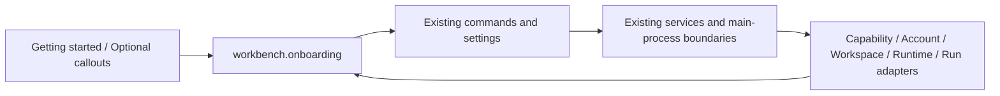

# Beginner onboarding proposal

[简体中文](onboarding-design.zh-CN.md) · Design proposal; not implemented.

## Goal and current foundation

Help a new user open a project, choose an environment, run code, see the result, and recover from failure. Understanding Docker, LSP, dependency generations, or plugins should not be a prerequisite.

The current architecture supports a first version without Go server changes. `client/src/settings.ts` provides `openFirstRun()` and `client/src/app.js` handles initial connection and local-only use. These mostly cover server configuration rather than the first successful run. The private renderer service registry already provides settings, serverCapabilities, cloudFeaturePolicy, workspaceLaunch, runtime, and runOutput.

## Page and interactions

Use a normal “Getting started” workbench tab, opened on first launch and available again through Help. It coordinates the existing connection flow; settings remain responsible for editing configuration. Reuse theme variables for Cloud Forge and support other themes.

```text
Getting started                                  [Maybe later]
Start with:   [Run in the cloud] [Open a local project]

First cloud run                                   2 / 5 complete
✓ Connect server       Secure connection verified    [Settings]
✓ Sign in              Account available              [Account]
→ Open project         Your project or a new example  [Open] [Example]
○ Choose environment   Recommended for your files     [Environments]
○ Run and see results  Complete one successful run    [Run]

Need help? [Connection diagnostics] [Guide]
Try next: completion · dependencies · debugging · collaboration
```

- Each step explains its purpose, current status, and one primary action. The first successful run is the core milestone. LSP, terminal, packages, and debugging are optional follow-ups.
- The local path covers opening a directory and editing. Cloud sign-in is not an error in that path. Self-hosting links to deployment documentation without deploying anything.
- Example creation requires directory selection and confirmation, writes only to a new directory, and never overwrites files. Prefer a Python example with no third-party packages when supported; otherwise offer an available language.
- Environment recommendations use the current server inventory. A recommendation does not prove an environment is installed or launchable; show unavailable states and next actions.
- Optional small callouts target stable semantic anchors such as Run and Output. They must not steal focus or cover editing. Fall back to the checklist when an anchor is missing; pause during workspace changes, dialogs, and active runs.
- Support skip, resume, and reset. Upgrades must not force users through completed onboarding. Feature announcements remain separate.

## Connection diagnostics

Report HTTP service, secure WebSocket handshake, authorization, runtime availability, and SSH/SFTP when relevant as separate states. Configuration is not verification; unsupported, unchecked, and failed are different outcomes.

The terminal bug fixed alongside this proposal illustrates the need: the actual connection used WSS, but its verifier received an HTTPS origin. Verify the actual connection URL; never disable certificate validation to complete onboarding. A pin mismatch should offer certificate details and connection settings, without automatically trusting a replacement certificate. Diagnostics are explicit, cancellable probes and must not launch containers, terminals, or LSP merely to fill a progress indicator.

## Service design

Introduce a private `workbench.onboarding` service for state reduction, next-action recommendations, and progress hints. Views render its state; existing commands or narrow ports perform actions. It owns no credentials and performs no raw networking or shell execution. It grants plugins no additional main-process authority.



Subscription coverage is incomplete today: serverCapabilities supports subscriptions; the workspaceLaunch host has `onDidOpen`, which must not be assumed to cover every close or switch; runOutput is an output facade without a general run-completion subscription. Add minimal read-only snapshots and semantic events to workspace lifecycle and run coordination, then inject adapters into onboarding. Do not poll the DOM, parse output text, or read scattered `window.BOBO` state to infer success. `runOutput.finish` is a presentation interface; authoritative run results determine completion.

Proposed events cover connection, authorization, workspace activation/clear, runtime selection, and run completion. Bind them to server/account identity, workspace revision, and operation id. Subscriptions are disposable, probes cancellable, and late results cannot update a different context. These missing contracts are implementation work, not existing capabilities.

Step states are `pending / checking / ready / blocked / skipped`. Only actual evidence marks a step ready. Historical first-run achievements and current readiness are separate: changing server, account, or workspace recalculates readiness without erasing history or presenting a historical badge as current health.

Persist only tutorial version, dismissed hints, and context-bound completion hints. Store no tokens, API keys, source, or terminal output. Recompute readiness at startup. Stopping onboarding releases only its subscriptions and probes; it does not stop user runs, sync, debugging, or language services. Workspace transitions reuse existing lifecycle policies.

## Delivery and acceptance

1. Add minimal state/event adapters, state reduction, and context isolation.
2. Build the checklist and diagnostics using existing settings, sign-in, workspace, and run actions. Include English, Simplified Chinese, Japanese, keyboard access, and screen-reader labels.
3. Add safe example creation, followed by optional contextual callouts.

Verify fresh profiles with no server, local editing, a valid private certificate, a wrong pin, expired authorization, no usable environment, recovery after run failure, late probes during workspace switches, restart/resume, and language changes. Completion requires a successful run for the current project in the active flow, not a Next click. Upgrading users with existing projects must not be interrupted.

Success means users can finish their first run, understand failures, and leave or resume the guide freely. The number of dialogs is not a measure of onboarding quality.
