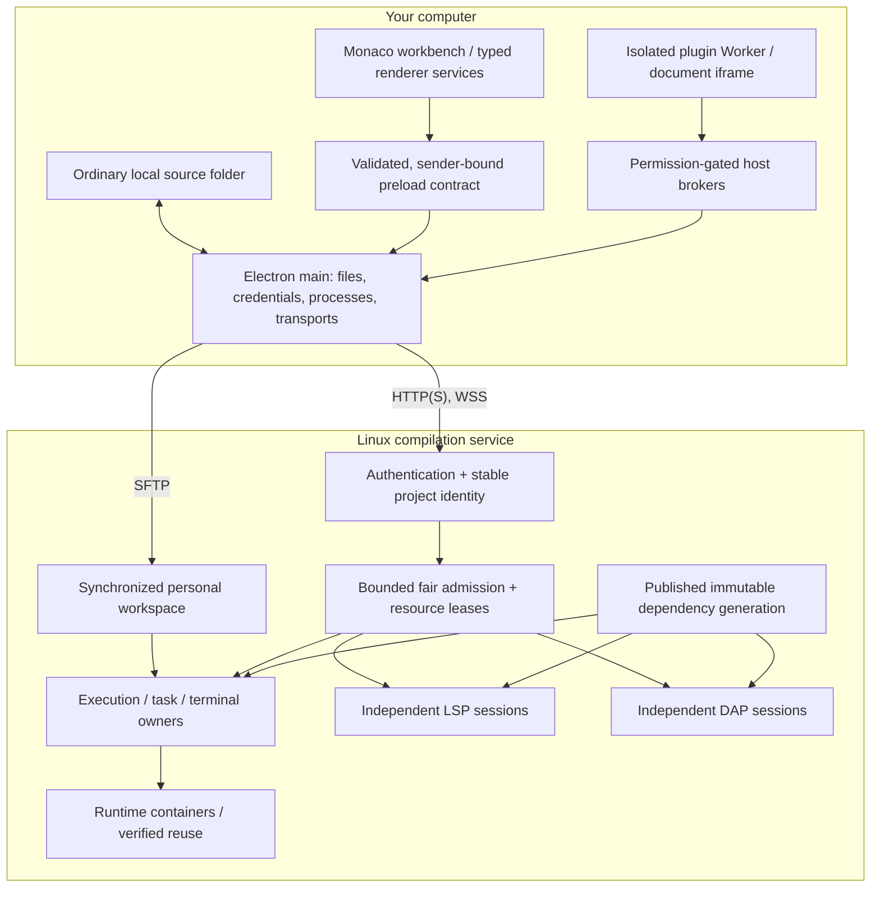
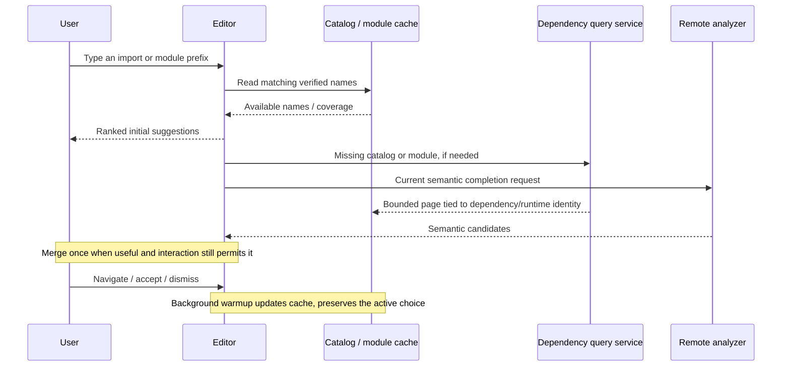
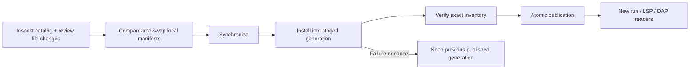

# Performance and architecture: what actually happens

[简体中文](performance-and-architecture.zh-CN.md) · [README](../README.md)

BOBOCLOUD optimizes repeated work and keeps long operations away from interaction paths. It still pays for network round trips, cold containers, cold analyzers, source synchronization, and compilation. This guide separates mechanisms from measurements; it does not claim a fixed speedup over a local IDE.

## 1. Three ownership boundaries

The renderer presents state; Electron main owns privileged desktop operations. The cloud resolves the authenticated owner and project before work that acquires resources or mutates managed state. Plugin code does not receive either side's unrestricted authority. A Docker-group service account still has substantial host authority; containers and plugin sandboxes are different boundaries, not a claim that the entire installation is safe for arbitrary hostile tenants without operator hardening.

## 2. Completion is several layers, not one remote round trip

The coordinator merges local rules/current symbols, cached names, and semantic language-server answers before final ranking and truncation. Import discovery is a small name catalog; a module summary is a public-name record; semantic completion carries analyzer edits and type context. These are not interchangeable.

### Three strategies, one bounded scheduler

- **On demand:** catalog first, then requested modules.
- **Smart:** additionally warms active-document imports after idle.
- **Project:** additionally traverses discoverable dependency modules/children progressively during idle.

The coordinator has one active dependency query at a time and prioritizes foreground work. Idle work yields around input, run/debug/sync activity, hidden documents, and lifecycle transitions. Short runtime-image probes use no-wait maintenance admission, no network or workspace mounts, bounded resources, and cleanup before lease release. An already running short query is not magically preempted the instant a key is pressed.

Names are isolated by server/account/workspace/language/runtime/dependency identity. A runtime's immutable image fingerprint participates in the new query revision. Reconnecting preserves verified complete records but restarts session-bound unfinished cursors. Retryable failure retains earlier pages and backs off; it does not become an authoritative empty catalog.

### Learning without an LLM

The learner combines accepted choices with stable manually written usage, canonicalizes import aliases, scopes preferences, and decays old weights. It avoids repeatedly counting rescans or delete/retype cycles; comments, strings, bulk-generated edits, and paste are treated conservatively. Persisted learning records contain symbol identities, counts, time, and opaque scope keys, not raw source. This is a ranking preference, not intent certainty or type inference.

### Coverage boundaries

| Adapter | What the summary can read | What still needs the analyzer |
| --- | --- | --- |
| Python | Module names, `.py`/`.pyi` declarations, aliases, bounded static re-exports. | Purely dynamic exports and extension APIs without static evidence. |
| Node / TypeScript | Package names, scoped names, package exports, declarations, simple CommonJS assignments. | Dynamic exports, full overload/type inference; builtin API semantics. |
| Go | Exported source declarations and supported module-cache ZIP surfaces. | Complete package/type/reference semantics and unsupported archive descendants. |
| Rust | Public crate-root declarations. | Macro expansion, complex module/re-export/type resolution. |
| Java | JAR package/class names. | Class accessibility, methods, signatures, inheritance. |
| C / C++ | Include names and simple function prototypes. | Macros, templates, complex types and overload resolution. |

Other configured languages retain their existing analyzer/local-rule behavior. Listing a language in the LSP catalog does not imply that it has every summary adapter above.

## 3. Large-workspace work is deferred and bounded

The initial tree enumerates immediate entries; folder expansion requests child pages. Quick Open separately scans files asynchronously, applies path exclusions, yields while processing renderer batches, and throttles filtering by 80 ms. A root/identity/generation change prevents an old scan from replacing the new project's index.

Budgets cover entries, depth, path length, watchers, and scan time. Therefore a large or unusual tree can be incomplete. The benefit is bounded startup/interaction work, not a guarantee every arbitrary-size workspace is fully indexed.

## 4. Cache domains and invalidation

| Domain | Main identity | Reuse and invalidation |
| --- | --- | --- |
| Project dependencies | Owner + stable project + immutable runtime + dependency manifest/lock + materialization policy. | Publish once, mount read-only, protect active readers; replace by a new generation. |
| Incremental compilation | Project + runtime/toolchain + dependency digest + build target. | Reuse compatible compiler state; different identities do not share writable targets. |
| Build artifacts | Normalized sources + compile plan/environment + runtime + dependencies. | Eligible compile stage may be skipped; execute the run stage again. |
| LSP analysis | Analyzer/toolchain + workspace/dependency projection. | Analyzer-owned state; separate from DAP. |
| Completion summaries | Server/account/project + language/runtime + combined dependency revision. | Bounded hot records, optional durable records, eviction, coverage checks. |
| DAP sessions/adapters | Adapter/runtime + debug lifecycle. | Independent protocol, processes, mounts, and cleanup. |

Never interpret build-cache hits as a replayed program result. Output, exit status, input, and side effects must not be served from the compile artifact cache. Do not interpret a completion summary as the authoritative installed-package inventory.

## 5. Dependency changes are transactions

The client persists an operation identity and local transaction state. If a response is lost after apply begins, it reconciles the same operation rather than assuming failure and installing twice. npm/pnpm/Python terminal package intents use the supported managed pipeline; arbitrary terminal filesystem changes remain isolated.

## 6. Sharing a host without unbounded queues

The resource ledger accounts for slots, containers, CPU, memory, PIDs, ephemeral bytes, inodes, and supported devices. Admission combines workload weights, owner/project fairness, project FIFO, queue bounds, cancellation, timeouts, fit-aware selection, and aging. A lease lasts until the actual process/container/mount cleanup is complete.

This improves resource governance, not raw hardware capacity. Small hosts can correctly reject or delay work. Raising a UI cache budget does not add server memory or containers. Operators should use stage metrics and queue pressure before increasing concurrency.

## 7. Evidence and a repeatable measurement plan

The checked-in demonstration uses a real root-authenticated **new project**, Python 3.12, and Cloud Forge. It verifies successful execution, completion, and run history; it is not an isolated benchmark. GIF pauses are edited. The output warning about omitted artifact files is preserved and is not presented as a failed program or a clean-artifact guarantee.

Controlled Electron regression observations for the completion popup:

| Scenario | Retriggers | Widget hides | Widget shows |
| --- | --- | --- | --- |
| First useful remote semantic answer | 1 | 0 | 0 |
| Six background pages, no navigation | 0 | 0 | 0 |
| Six further pages after manual selection | 0 | 0 | 0 |

The tests observe real Monaco events; they establish interaction behavior under the fixture, not Internet P95 latency. Regression tests also cover using records passed through the real disk-cache sanitizer, including omitted empty arrays.

For your deployment:

1. Record client/server revision, hardware, available capacity, image/toolkit versions, project/dependency digest, network RTT, and cache state.
2. Separate cold image pull, cold analyzer, cold module summary, and warm reuse. Do not call all four simply “startup.”
3. Run multiple samples under comparable load. Use stage timings and P50/P95/P99 rather than the best GIF frame.
4. Verify correctness: current output on every run, expected definitions/completions, no stale workspace results, preserved manual choice, and released resources.
5. Report coverage and failures alongside latency. Test cancellation and dependency changes as well as warm hits.

The administrative performance view exposes bounded stage measurements; `/healthz`, `/readyz`, `serverInfo`, and structured logs answer different questions. Run history supplies identities and retained results, not a substitute for controlled metrics.

## Source and tests

| Topic | Code | Useful tests |
| --- | --- | --- |
| Completion coordination | [completion-coordinator.ts](../client/src/completion-coordinator.ts), [lsp-client.js](../client/src/lsp-client.js) | [Coordinator](../client/tests/completion-coordinator.test.js), [integration](../client/tests/lsp-completion-integration.test.js), [Electron LSP](../client/tests/lsp-ui.spec.js). |
| Learned ranking | [completion-history.js](../client/src/completion-history.js) | [Learning regressions](../client/tests/completion-history.test.js). |
| Durable summaries | [client-analysis-cache.js](../client/client-analysis-cache.js) | [Cache contract](../client/tests/client-analysis-cache.test.js). |
| Dependency queries | [dependency_queries.go](../server/internal/lsp/dependency_queries.go) | [Query adapters](../server/internal/lsp/dependency_queries_test.go). |
| Runtime discovery | [runtime_dependency_query.go](../server/internal/lsp/runtime_dependency_query.go), [governed handler](../server/internal/handler/lsp_runtime_dependencies.go) | [Probe tests](../server/internal/lsp/runtime_dependency_query_test.go). |
| Workspace / Quick Open | [workspace.js](../client/main/workspace.js), [file-search.ts](../client/src/file-search.ts) | [Workspace scale](../client/tests/workspace-scale-ui.spec.js). |
| Compile reuse | [personalcache](../server/internal/personalcache/), [runner](../server/internal/runner/) | Package-local Go tests. |
| Resource ownership | [resourcecontrol](../server/internal/resourcecontrol/), [resourcegovernor](../server/internal/resourcegovernor/) | Queue, cancellation, fairness, and cleanup Go tests. |

Read [CONTRIBUTING](../CONTRIBUTING.md) before changing these boundaries.
