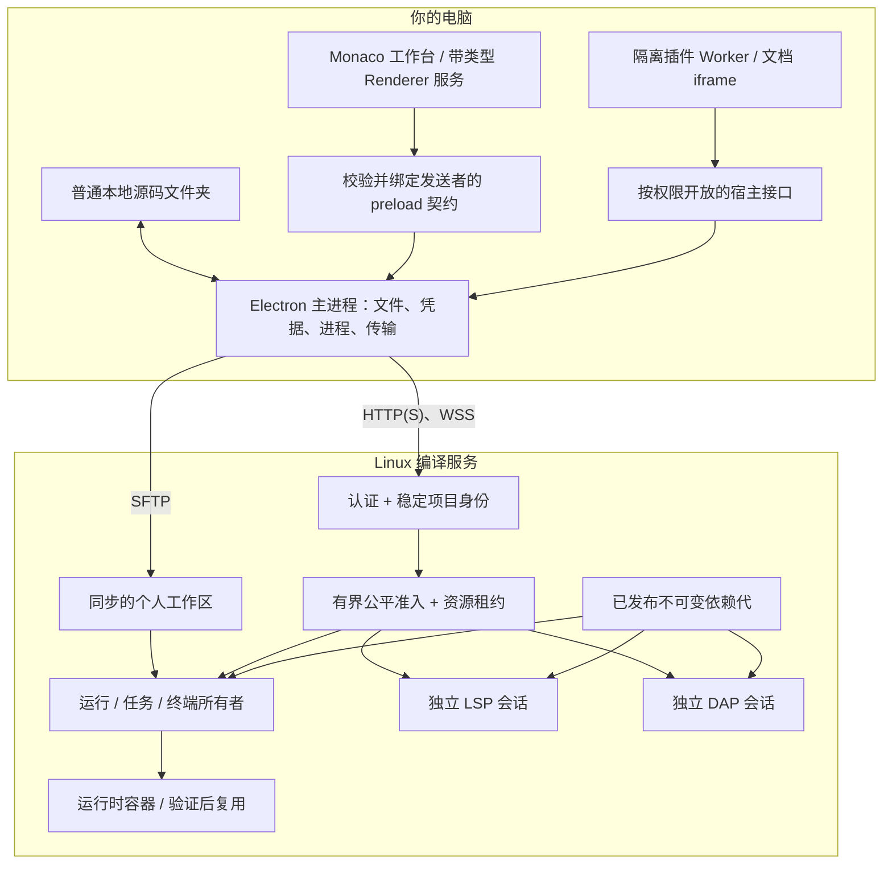
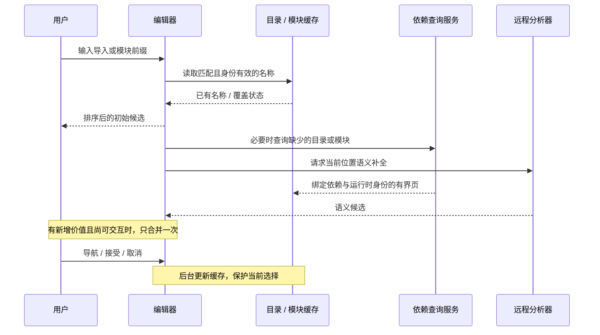
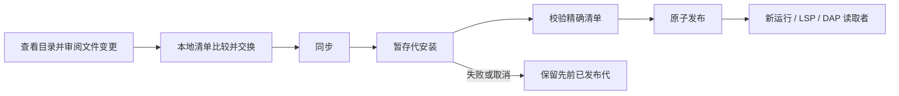

# 性能与架构：实际发生了什么

[English](performance-and-architecture.en.md) · [README](../README.zh-CN.md)

BOBOCLOUD 主要减少重复工作，并把长操作移出交互路径。网络往返、冷容器、冷分析器、源码同步和编译成本仍然存在。本文把机制与测量分开，不承诺相对本地 IDE 的固定加速倍数。

## 1. 三层所有权边界

Renderer 展示状态，Electron main 拥有桌面特权操作。云端在申请资源或修改受管状态前确定认证账号与项目身份。插件不能获取这两侧的无限权限。加入 Docker 组的服务账号依然拥有很强的主机权限；容器与插件沙箱是不同边界，不意味着任意配置下都能安全开放给恶意租户，运维仍需加固。

## 2. 补全有多层，不是每个字都等一次远程往返

协调层合并本地规则/当前符号、缓存名称和语义语言服务结果，最后排序再截断。导入发现是名称目录，模块摘要是公开名称记录，语义补全带有分析器编辑和类型上下文；三者不能互相冒充。

### 三种策略，一个有界调度器

- **按需：**先目录，再查询需要的模块。
- **智能：**空闲后额外预热当前文档导入。
- **项目：**空闲时继续渐进遍历可发现的依赖模块和子模块。

协调器同时只执行一个依赖查询，前台工作优先。空闲工作会在输入、运行/调试/同步、文档隐藏及生命周期切换时让路。短运行时镜像探测使用不等待的维护资源准入，没有网络或工作区挂载，资源受限，容器清理后才释放租约。已经运行的短查询不会在按键瞬间被神奇地抢占。

名称按服务器、账号、工作区、语言、运行时和依赖身份隔离。新的查询 revision 包含运行时不可变镜像指纹。重连保留已验证的完整记录，重启绑定旧会话的未完成游标。可重试失败保留先前页面并退避，不会保存成权威空目录。

### 不依赖 LLM 的使用学习

学习器组合明确接受与稳定手写使用，归一化导入别名、按上下文隔离偏好，并让旧权重衰减。重复扫描、删除重输不会反复刷分；注释、字符串、批量生成和粘贴保守处理。持久记录只包含符号身份、计数、时间和不透明作用域键，不包含原始源码。这是排序偏好，不是意图确定性判断或类型推断。

### 覆盖边界

| 适配器 | 摘要可以读取 | 仍需分析器 |
| --- | --- | --- |
| Python | 模块名、`.py`/`.pyi` 声明、别名、有界静态重导出。 | 无静态证据的动态导出与扩展 API。 |
| Node / TypeScript | 包名、作用域包、package exports、声明、简单 CommonJS 赋值。 | 动态导出、完整重载/类型推断及内置 API 语义。 |
| Go | 公开源码声明及支持的模块缓存 ZIP 内容。 | 完整包/类型/引用语义及未支持的压缩包子包。 |
| Rust | crate 根的公开声明。 | 宏展开、复杂模块/重导出/类型解析。 |
| Java | JAR 的包和类名。 | 类可见性、方法、签名、继承。 |
| C / C++ | include 名称和简单函数原型。 | 宏、模板、复杂类型与重载决议。 |

其它已配置语言继续使用已有分析器和本地规则。语言出现在 LSP 目录里，不代表具备上表所有摘要能力。

## 3. 大工作区工作延后且有界

初始树只枚举当前层，展开文件夹时请求子项分页。Quick Open 独立异步扫描文件、应用路径排除、分批处理时让出事件循环，并以 80 ms 节流过滤。根目录、身份或代次变化会阻止旧扫描覆盖新项目索引。

目录项、深度、路径长度、监听器和扫描时间均有预算，因此超大或特殊目录可能只有部分覆盖。优化目标是限制启动和交互路径的工作量，不是保证任意大小的工作区都完整索引。

## 4. 缓存域与失效

| 缓存域 | 主要身份 | 复用和失效规则 |
| --- | --- | --- |
| 项目依赖 | 账号、稳定项目、不可变运行时、清单/锁文件及物化策略。 | 发布后只读挂载，保护活动读取者，用新一代替换。 |
| 增量编译 | 项目、运行时/工具链、依赖摘要、构建目标。 | 复用兼容编译器状态，不同身份不共享可写目标。 |
| 构建产物 | 规范化源码、编译计划/环境、运行时和依赖。 | 满足条件时跳过编译阶段，运行阶段仍执行。 |
| LSP 分析 | 分析器/工具链及工作区/依赖投影。 | 分析器自有状态，与 DAP 分离。 |
| 补全摘要 | 服务器/账号/项目、语言/运行时、组合依赖 revision。 | 有界热记录、可选持久记录、淘汰和覆盖校验。 |
| DAP 会话/适配器 | Adapter/运行时和调试生命周期。 | 独立协议、进程、挂载及回收。 |

编译缓存命中不能被解释为重放程序结果。输出、退出码、输入与副作用不得来自产物缓存。补全摘要也不能被当作权威安装清单。

## 5. 依赖变更是一笔事务

客户端保留 operation 身份及本地事务状态。开始应用后丢失响应时，会按同一操作对账，不会直接假定失败再安装两次。受支持的 npm/pnpm/Python 终端安装意图进入同一受管流程；任意终端文件变更仍在隔离副本中。

## 6. 共享主机，不堆积无上限队列

资源账本记录槽位、容器、CPU、内存、PID、临时字节、inode 和支持的设备。准入组合工作权重、账号/项目公平、项目 FIFO、有界队列、取消、超时、按资源适配选择及老化。直到真实进程、容器和挂载清理结束，租约才释放。

它改进资源治理，不会增加硬件容量。小主机可能正确地拒绝或延迟请求，提高 UI 缓存预算也不会增加服务器内存或容器。运维应先检查阶段指标和队列压力，再决定并发数。

## 7. 证据与可重复测量

本次素材使用真实 root 登录下的**新项目**、Python 3.12 和 Cloud Forge，核验执行成功、补全和运行记录，不是隔离基准测试。GIF 的等待片段经过编辑；产物文件被省略的警告保留，不把它解释为程序失败，也不把演示声称为产物回传完全无警告。

受控 Electron 回归观测：

| 场景 | 重触发 | 补全框隐藏 | 补全框显示 |
| --- | --- | --- | --- |
| 首个有用远端语义回答 | 1 | 0 | 0 |
| 无操作连续返回六页后台结果 | 0 | 0 | 0 |
| 手动选择后再返回六页 | 0 | 0 | 0 |

测试监听真实 Monaco 事件，证明夹具条件下的交互行为，不代表互联网 P95 延迟。回归也覆盖真实磁盘缓存清洗后的记录，包括空数组被省略的情况。

测量自己的部署时：

1. 记录客户端/服务版本、硬件、可用容量、镜像/工具链版本、项目/依赖摘要、RTT 及缓存状态。
2. 分开冷镜像拉取、冷分析器、冷模块摘要和热复用，不把它们统称“启动”。
3. 在可比较负载下多次采样，使用阶段耗时及 P50/P95/P99，不取 GIF 中最好的一帧。
4. 同时验证正确性：每次运行都有当前输出、补全/跳转正确、没有旧工作区结果、保留手选项、资源已回收。
5. 覆盖状态和失败与延迟一起报告，测试取消和依赖变化，不只测命中。

管理性能页提供有界阶段数据，`/healthz`、`/readyz`、`serverInfo` 和结构化日志分别回答不同问题。运行历史提供身份与保留结果，不能替代受控指标。

## 代码与测试入口

| 主题 | 代码 | 有用测试 |
| --- | --- | --- |
| 补全协调 | [completion-coordinator.ts](../client/src/completion-coordinator.ts)、[lsp-client.js](../client/src/lsp-client.js) | [协调器](../client/tests/completion-coordinator.test.js)、[接线](../client/tests/lsp-completion-integration.test.js)、[Electron LSP](../client/tests/lsp-ui.spec.js)。 |
| 学习排序 | [completion-history.js](../client/src/completion-history.js) | [学习回归](../client/tests/completion-history.test.js)。 |
| 持久摘要 | [client-analysis-cache.js](../client/client-analysis-cache.js) | [缓存契约](../client/tests/client-analysis-cache.test.js)。 |
| 依赖查询 | [dependency_queries.go](../server/internal/lsp/dependency_queries.go) | [查询适配器](../server/internal/lsp/dependency_queries_test.go)。 |
| 运行时发现 | [runtime_dependency_query.go](../server/internal/lsp/runtime_dependency_query.go)、[受管 handler](../server/internal/handler/lsp_runtime_dependencies.go) | [探测测试](../server/internal/lsp/runtime_dependency_query_test.go)。 |
| 工作区 / Quick Open | [workspace.js](../client/main/workspace.js)、[file-search.ts](../client/src/file-search.ts) | [工作区规模](../client/tests/workspace-scale-ui.spec.js)。 |
| 编译复用 | [personalcache](../server/internal/personalcache/)、[runner](../server/internal/runner/) | 各包 Go 测试。 |
| 资源所有权 | [resourcecontrol](../server/internal/resourcecontrol/)、[resourcegovernor](../server/internal/resourcegovernor/) | 队列、取消、公平和回收 Go 测试。 |

改动这些边界前，请阅读[贡献指南](../CONTRIBUTING.zh-CN.md)。
